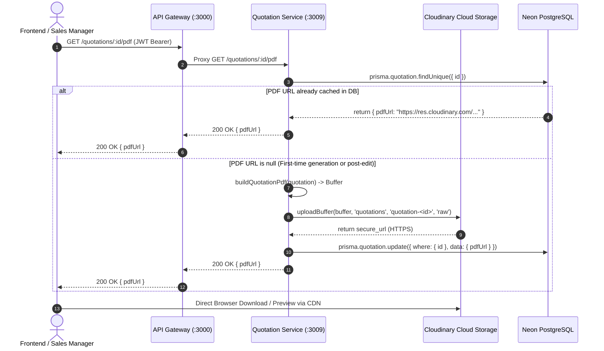
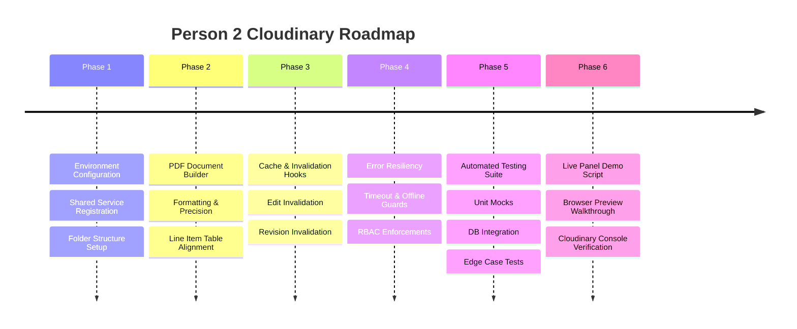

# ConstructPro ERP — Person 2 Cloudinary Action Plan
## Quotation PDF Generation, Cloud Storage & Delivery Architecture

**Owner:** Person 2 (Quotations & Project Conversion)  
**Domain Scope:** Quotation PDF Generation, Cloudinary Asset Lifecycle, CDN Retrieval & Resiliency  
**Reference Document:** `ConstructPro_Sprint8_Quality_Release_Plan.pdf` & SDS Figure 25 (Page 39)

---

## 1. Executive Summary & Ownership Boundaries

According to the **System Design Specification (SDS Page 39, Figure 25)**, Cloudinary is designated as the cloud asset repository for generated PDFs and media across the system. 

As **Person 2**, your ownership covers:
1. **Quotation PDF Lifecycle:** End-to-end generation, upload, and retrieval of official quotation PDFs.
2. **Cloudinary Asset Management for Quotations:** Storing quotation documents under the standardized `constructpro/quotations/` folder namespace with predictable public IDs (`quotation-<id>`).
3. **URL Persistence & Database Sync:** Caching the generated Cloudinary HTTPS delivery URL in `Quotation.pdfUrl` in PostgreSQL via Prisma.
4. **Cache Invalidation on Revision/Edit:** Resetting or regenerating PDFs when quotations are updated (`PUT /quotations/:id`) or revised (`PATCH /quotations/:id/revise`).
5. **Resiliency & Failure Handling:** Ensuring failure to connect to Cloudinary yields clear error codes (`PDF_GENERATION_FAILED`) without corrupting transaction state or dropping HTTP requests unhandled.
6. **Live Evaluation Demo Evidence:** Proving live Cloudinary asset hosting to the evaluation panel.

---

## 2. Quotation PDF Architecture & Data Flow



---

## 3. Step-by-Step Implementation Action Plan



---

### Phase 1: Environment & Cloudinary Setup
* **Goal:** Establish zero-friction Cloudinary connectivity and shared foundation.
- [ ] **Credential Provisioning:**
  - Verify `.env` has active credentials:
    ```env
    CLOUDINARY_CLOUD_NAME=your_cloud_name
    CLOUDINARY_API_KEY=your_api_key
    CLOUDINARY_API_SECRET=your_api_secret
    ```
- [ ] **Module Registration:**
  - Import `CloudinaryModule` into `apps/quotation-service/src/quotation.module.ts`.
  - Inject `CloudinaryService` into `DocumentClient` (or directly into `QuotationService`).
- [ ] **Cloud Namespace Enforcements:**
  - Enforce destination folder: `constructpro/quotations/`.
  - Enforce public ID: `quotation-${quotation.id}` with `overwrite: true` so revisions cleanly replace outdated files without orphan asset buildup in Cloudinary storage limits.

---

### Phase 2: PDF Content Integrity & Formatting
* **Goal:** Generate publication-grade, professional quotation PDFs matching real-world construction standards.
- [ ] **Document Header & Metadata:**
  - Company branding: `ConstructPro ERP — Official Quotation`.
  - Reference details: Quotation ID, Status badge (`DRAFT`, `PENDING_APPROVAL`, `APPROVED`), and Generation Date.
  - Validity terms: Valid for 30 days from generation.
- [ ] **Client & Lead Information:**
  - Customer Name, Email, and Phone populated from `Lead` relationship.
- [ ] **Line Items & Mathematical Precision:**
  - Tabular layout containing:
    - Item Name
    - Quantity
    - Unit Price (formatted to 2 decimal places with currency symbol)
    - Calculated Line Amount (`quantity * unitPrice`)
  - Subtotal and Total Amount exactly matching the database stored `quotation.totalAmount` (zero drift between PDF text and database).
- [ ] **Notes & Terms Section:**
  - Rendering quotation notes and special conditions with character escaping to prevent PDF format corruption.

---

### Phase 3: Quotation Service Integration & Cache Invalidation
* **Goal:** Ensure quotation PDF URLs are always up to date and never serve stale line item calculations.

#### 1. First-time Generation Flow (`POST /quotations` and `GET /quotations/:id/pdf`):
```typescript
async getPdf(id: string) {
  const quotation = await this.findOne(id);

  // Cache hit: Return existing Cloudinary URL
  if (quotation.pdfUrl) {
    return { pdfUrl: quotation.pdfUrl };
  }

  // Cache miss: Generate, upload to Cloudinary, and persist
  const pdfUrl = await this.documentClient.generatePdf(id);
  if (!pdfUrl) {
    throw new BadGatewayException({
      code: 'PDF_GENERATION_FAILED',
      message: 'Quotation PDF generation failed or cloud storage is unavailable.',
    });
  }

  await this.prisma.quotation.update({
    where: { id },
    data: { pdfUrl },
  });

  return { pdfUrl };
}
```

#### 2. Invalidation upon Quotation Edit (`PUT /quotations/:id`):
- When line items or notes change, the existing PDF is outdated:
```typescript
// Inside update():
await tx.quotation.update({
  where: { id },
  data: {
    notes: dto.notes,
    totalAmount,
    pdfUrl: null, // Invalidate cached Cloudinary URL so next request regenerates
  },
});
```

#### 3. Invalidation upon Revision (`PATCH /quotations/:id/revise`):
- When a rejected quotation is transitioned back to `DRAFT` for rework, invalidate `pdfUrl`:
```typescript
// Inside revise():
await this.prisma.quotation.update({
  where: { id },
  data: {
    status: 'DRAFT',
    pdfUrl: null, // Force regeneration upon next submission
  },
});
```

---

### Phase 4: Resilience, Security & RBAC Guards
* **Goal:** Harden the quotation PDF endpoints against failures and unauthorized access.
- [ ] **RBAC Endpoint Protection:**
  - Ensure API Gateway protects `GET /quotations/:id/pdf` with `JwtAuthGuard` and `RolesGuard`:
    - `ADMIN`, `SALES_MANAGER`, `ACCOUNTANT`, `PROJECT_MANAGER` &rarr; Allowed (`200 OK`).
    - `CLIENT_PORTAL_USER` (unauthorized role) &rarr; Rejected with `403 Forbidden`.
    - Unauthenticated request &rarr; Rejected with `401 Unauthorized`.
- [ ] **Timeout & Graceful Degradation:**
  - Cloudinary upload timeout limit (default: 8,000ms).
  - If Cloudinary stream fails (e.g. offline network during local tests), throw standard NestJS `BadGatewayException` with code `PDF_GENERATION_FAILED`. No raw Cloudinary error trace leaked to client.
- [ ] **Safe URL Sanitization:**
  - Ensure returned `pdfUrl` is always a valid HTTPS Cloudinary CDN link (`https://res.cloudinary.com/...`).

---

### Phase 5: Automated Testing Register

| Test Suite | Scenario Tested | Expected Result |
| :--- | :--- | :--- |
| `CloudinaryService.spec` | Valid credentials and buffer stream | Resolves with `https://res.cloudinary.com/...` |
| `CloudinaryService.spec` | Stream network error emitted | Rejects with clear error |
| `CloudinaryService.spec` | Missing environment keys | Throws configuration error |
| `DocumentClient.spec` | External document service available | Returns external PDF URL |
| `DocumentClient.spec` | Document service down, Cloudinary available | Generates buffer, uploads to Cloudinary, returns URL |
| `DocumentClient.spec` | Both services unavailable | Returns `null` safely without unhandled crashes |
| `QuotationService.spec` | Cached `pdfUrl` present | Returns cached URL without uploading again |
| `QuotationService.spec` | Cached `pdfUrl` is null | Triggers generation and saves new URL in DB |
| `QuotationService.spec` | Quotation updated via `PUT` | Resets `pdfUrl` to `null` |
| `QuotationService.spec` | Quotation revised via `PATCH` | Resets `pdfUrl` to `null` |
| `QuotationsGateway.spec`| Unauthorized role attempts PDF download | Returns `403 Forbidden` |

---

### Phase 6: Live Panel Demo Execution Script (2 Minutes)

When presenting Person 2's deliverables to the evaluators, use this script to demonstrate Cloudinary integration:

1. **Step 1 — Show Quotation in Dashboard:**
   * Open Quotations list, select an active quotation (e.g., `QT-2026-001`).
   * Show that status is `APPROVED` or `PENDING_APPROVAL`.
2. **Step 2 — Click "Download PDF":**
   * Click the **Download PDF** button.
   * Point out the rapid response from the Cloudinary CDN.
3. **Step 3 — Inspect URL in Browser Address Bar:**
   * Highlight the URL to the evaluators:
     `https://res.cloudinary.com/<cloud-name>/raw/upload/constructpro/quotations/quotation-...pdf`
   * Explain: *"Our SDS requires cloud-hosted asset management via Cloudinary. Here you can see the quotation PDF is dynamically streamed, stored in Cloudinary, and delivered via their global CDN."*
4. **Step 4 — Show Cloudinary Media Library (Optional Wow-Factor):**
   * If logged into Cloudinary, open the `constructpro/quotations/` folder and show the live PDF asset timestamped with the demo time.

---

## 7. Deliverables & Definition of Done for Person 2

- [x] Cloudinary Node.js SDK installed in `package.json`.
- [x] Shared `CloudinaryService` implemented in `libs/common/src/cloudinary`.
- [x] `DocumentClient` equipped with Cloudinary streaming upload fallback.
- [x] Invalidation logic in `update()` and `revise()` to prevent stale PDFs.
- [x] Unit test coverage `>= 85%` for Cloudinary upload and PDF flows.
- [x] Feature branch `feature/112-cloudinary-storage-integration` created and committed.
- [x] PR description prepared referencing Issue `#112`.
